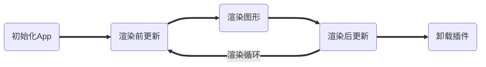

### 插件系统

以 `system` 结尾的，属于插件系统，插件系统通过生命周期钩子注册到主应用中。

插件提供 `install` 方法，该方法选择性返回一个 `prior` 属性来调整其执行优先级，优
先级越大则会更快执行。`prior` 仅在未显式指定安装优先级时，作为默认值调用。插件在
安装时可以通过 `options` 属性配置优先级。

```js
App.install(plugin, {
   prior: 1,
});
```

### 生命周期钩子

整个插件生命周期为以下步骤：



---

#### 初始化钩子

插件 `Plugin` 注入实际为初始化 App 中，初始化 App 提供以下钩子：

-  `init()`

这些钩子的调用时机发生在 App 正式创建过后，按照插件优先级以此执行。

#### 更新钩子

渲染更新钩子位于每一次事件循环中调用，相较于图形渲染钩子，其是否调用不受渲染标志
`renderFlag` 控制，不论是否进行渲染，都会进行更新。

更新钩子应当能够控制渲染图形步骤是否执行，通过每一个动画帧的条件判断来确定。

一旦渲染标志在更新中被确定，不应该在后续更新中被修改。

更新钩子主要包含以下几种：

-  渲染前更新（预更新）
   -  `preUpdate()`
-  渲染后更新（后更新）
   -  `postUpdate()`

#### 渲染钩子

渲染钩子是最为复杂的钩子，其提供了对渲染流程的精细化控制，插件系统应该有能力为其
中任何一个步骤进行定制，对其造成影响。

为了达到多个插件协作的功能，应当实现链式调度器，通过中间件实现控制。

在正常情况下，渲染流程为：

1. 获取要渲染的图形
2. 过滤渲染图形
3. 计算图形信息
4. 绘制图形
5. 清理绘制信息

对于每个步骤，首先检查是否存在调度器，存在调度器则根据调度器优先级大小先后进行调
用。

这些调度器通过以下钩子注入：

-  `getShapes()`
-  `filterShapes()`
-  `calculateData()`
-  `renderShape()`
-  `cleanup()`

每个钩子会被注入当前可控制的上下文信息，以便更自由地进行控制。

#### 卸载钩子

当满足一定条件时，插件将被卸载。插件一旦被卸载，不论当前渲染周期是否完成，都不会
再继续执行接下来的钩子。卸载操作无法由开发者控制，但是能声明卸载伴随的处理函数，
可用于清理残留。

---

App 渲染周期中宏观发生的事件通过渲染周期钩子进入渲染循环中进行。

### ✉️ 事件总线

App 中各个模块之间通过时间总线进行交流。当事件被触发时，发布者发布事件，订阅者接
收发布信息并执行回调函数。

事件订阅可以发生在生命周期中的任意时刻，不过其必须保证在其卸载的同时会从订阅者列
表中被移除。

当 App 初始化时，事件总线管理器会在 App 中被创建，任何插件可以在管理器中创建自己
的事件总线（需要全局唯一 ID）。其他模块需要订阅事件时，首先通过管理器获取事件总
线，随后订阅到指定事件。

事件总线是 App 的脱围机制，通过事件总线可以将 App 与外界相互连接，交换信息。为了
保证事件的类型安全，可以继承 AppEvent 定义对应的事件参数和名称，不推荐使用字符串
ID，应该将其保存在常量中以保证类型安全。

### 按需更新、按需渲染

#### 按需更新

在原来的程序中，更新与渲染紧密耦合，这意味着 `requestRerender()` 引起的全量渲染
必然会导致全量更新，这非常没有必要，对性能也十分不利。

为了实现图形的按需更新，我们引入依赖列表，通过判断依赖列表是否发生变化，来确定是
否需要重新计算图形信息。图形信息的计算应当是一次性的，不应该需要多次更新才能被计
算完成。

#### 按需渲染

在原来的应用中，按需渲染由 `App.requestRender()` 方法提供。通过在单次浏览器事件
循环中合并渲染请求，在宏任务中进行重渲染，我们实现了按需渲染。但是这样的方法有个
非常大的弊端：由于其是在宏任务中执行重渲染，会导致帧率无法达到 60 帧。所以重构后
改为在 `requestAnimationFrame` 中执行重渲染，这样可以保证程序的丝滑更新。

### 响应式属性

在先前的程序中，所有的属性都为非响应式的，这就意味着如果我们要监听属性的变化，只
能通过向图形对象内注入更新方法或者在外部定义更新方法才能实现。在本次重构中，我们
借助 `Rx.js` 将图形的属性转变为 `Observale` 对象，并通过订阅可观察对象来实现响应
式。
